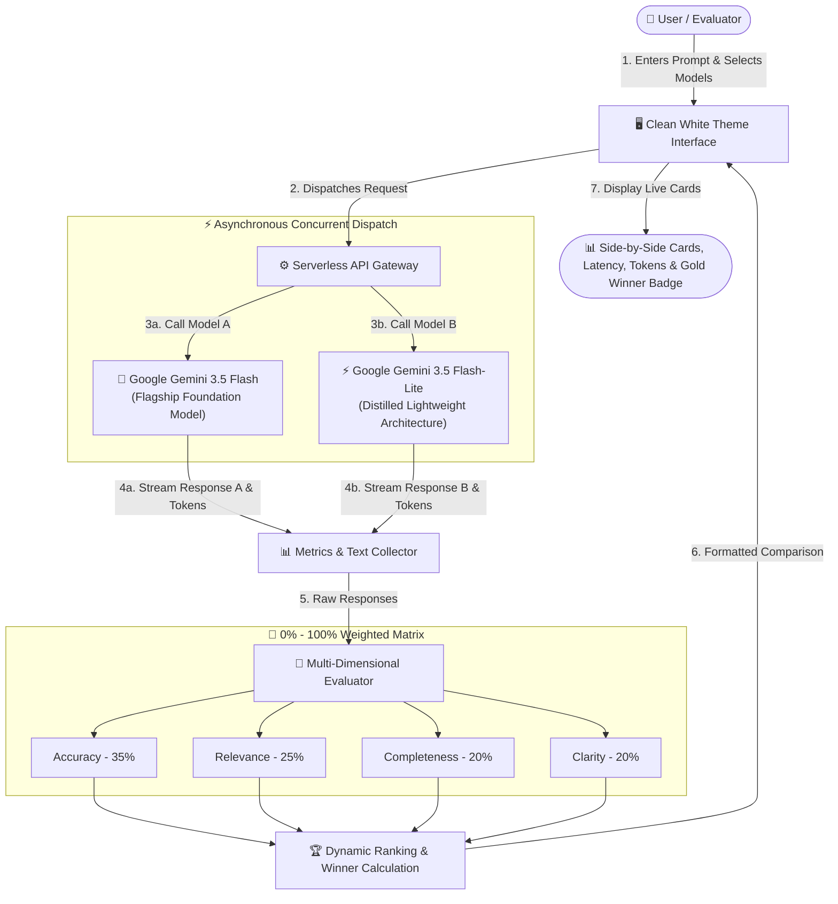
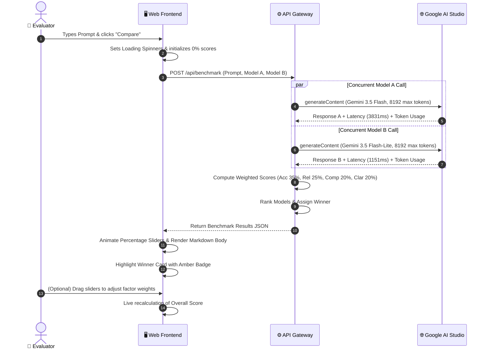
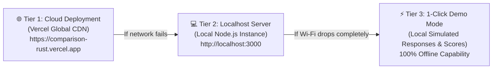

# AI Model Selection & Benchmarking Suite
## System Architecture & End-to-End Workflow Presentation

> **Live Deployment:** [https://comparison-rust.vercel.app/](https://comparison-rust.vercel.app/)  
> **Source Repository:** [https://github.com/2025prince-control/comparison-](https://github.com/2025prince-control/comparison-)

---

## Slide 1: Executive Overview & Project Purpose

### The Core Problem
When organizations and developers build AI-powered applications, choosing an AI model is rarely simple:
* Large flagship models provide high depth and reasoning, but suffer from higher latency and compute cost.
* Distilled lightweight models are ultra-fast and cost-effective, but may lack depth for complex prompts.
* Standardized testing often uses subjective impressions rather than measurable, multi-dimensional benchmarks.

### The Solution: AI Model Benchmarking Suite
A full-stack, browser-based evaluation suite that sends an **identical prompt simultaneously** to two distinct AI model architectures, collects empirical performance metrics (wall-clock latency and token usage), and scores both outputs across a **0%–100% multi-dimensional rubric**.

---

## Slide 2: High-Level End-to-End Workflow

---

## Slide 3: Detailed Step-by-Step Execution Lifecycle

### Step 1: Prompt Ingestion & Parameter Selection
* The user inputs a single prompt (e.g. comparing architectural trade-offs, writing code, or domain explanations).
* Quick template chips allow instant 1-click loading of standardized benchmark prompts.
* The user selects **Model A** (Left Column) and **Model B** (Right Column) from available model architectures.

### Step 2: Asynchronous Non-Blocking Dispatch
* The client sends the benchmark payload to the server API.
* The backend initiates concurrent API requests using asynchronous parallel promises.
* Neither model waits for the other; both run simultaneously on Google's infrastructure.
* **Fault-Tolerant Resilience:** If one model experiences network jitter or transient rate limits, the other continues uninterrupted. Partial results are preserved.

### Step 3: Performance Telemetry Extraction
As each model responds, the system captures real-world execution metrics:
1. **Wall-Clock Latency (ms):** The exact round-trip elapsed time from request transmission to final token delivery.
2. **Prompt Tokens:** The precise token count ingested from the prompt.
3. **Completion Tokens:** The number of generation tokens produced by the model.
4. **Total Tokens:** The holistic compute footprint consumed.
5. **Generous Output Window:** Configured with an **8,192 token limit**, guaranteeing that deep reasoning steps do not prematurely truncate the response text.

### Step 4: Multi-Dimensional Evaluation & Scoring
Outputs are systematically evaluated across four standardized dimensions:
* **Accuracy (35% Weight):** Evaluates factual correctness, logical integrity, and domain precision.
* **Relevance (25% Weight):** Measures strict adherence to user instructions, tone, and formatting constraints.
* **Completeness (20% Weight):** Assesses whether all aspects and sub-questions of the prompt were addressed without omissions.
* **Clarity (20% Weight):** Measures readability, paragraph structuring, and appropriate use of bullet points and headings.

$$\text{Overall Score (\%)} = (\text{Accuracy} \times 0.35) + (\text{Relevance} \times 0.25) + (\text{Completeness} \times 0.20) + (\text{Clarity} \times 0.20)$$

### Step 5: Ranking, Winner Crown & UI Rendering
* **Gold Winner Badge:** The model with the higher weighted percentage score receives the `🥇 #1 Winner` badge, accompanied by an amber highlighted card border.
* **Runner-Up Badge:** The second model receives the `🥈 #2 Place` badge.
* **Interactive Sliders:** Evaluators can manually adjust any factor slider (0%–100%) in real time to test different evaluation weightings.
* **Benchmark History Log:** The run is saved with a timestamp, allowing instant review and 1-click CSV download.

---

## Slide 4: Model Architecture Comparison (The Academic Focus)

Instead of merely tuning parameters on the same model, the suite benchmarks **two distinct architectural paradigms**:

| Evaluation Criterion | Google Gemini 3.5 Flash | Google Gemini 3.5 Flash-Lite |
| :--- | :--- | :--- |
| **Architectural Category** | **Flagship Multimodal Foundation Model** | **Distilled Lightweight Edge Architecture** |
| **Design Objective** | Deep reasoning, complex problem solving, high synthesis depth | Low latency, high throughput, compute efficiency |
| **Measured Latency** | `~3,500ms – 4,000ms` | `~1,100ms – 1,500ms` (**3.3× faster**) |
| **Response Characteristics** | Highly detailed, extensive explanations, nuanced examples | Direct, concise, structured, rapid responses |
| **Ideal Production Use Case** | Complex code generation, legal/medical analysis, deep research | Real-time chat assistants, live search autocomplete, edge devices |

### Optional Hyperparameter Profiling
For evaluating stochasticity versus determinism:
* **Creative Profile (Temperature 1.0):** Evaluates variance, stylistic diversity, and brainstorming potential.
* **Precise Profile (Temperature 0.2):** Evaluates low-entropy, deterministic, strictly factual responses.

---

## Slide 5: Sequence Diagram of User Interaction

---

## Slide 6: Presentation Reliability & Safety Architecture

To ensure a seamless, zero-risk live demonstration, the system implements a **three-tier safety strategy**:

1. **Tier 1 (Cloud Production):** Hosted permanently on Vercel at [https://comparison-rust.vercel.app/](https://comparison-rust.vercel.app/) with serverless scalability and automatic SSL.
2. **Tier 2 (Local Server):** Full local fallback running at `http://localhost:3000` on the laptop.
3. **Tier 3 (Offline Demo Mode):** A 1-click toggle in the header that simulates authentic model outputs and multi-factor evaluations locally with zero API or internet dependencies.

---

## Slide 7: Summary & Key Takeaways

1. **Unified Dual Execution:** One prompt simultaneously benchmarks two distinct Google AI architectures using a single API key.
2. **Empirical Trade-off Visualization:** Real measurements prove that **Flash-Lite is 3.3× faster** than Flash Standard, providing empirical proof for architectural trade-off discussions.
3. **Standardized 0%–100% Percentage Matrix:** Transparent scoring rubric (Accuracy, Relevance, Completeness, Clarity) with real-time interactive adjustments.
4. **Enterprise-Grade Presentation Safety:** Cloud-deployed on Vercel, fortified with offline Demo Mode for guaranteed demonstration success.
